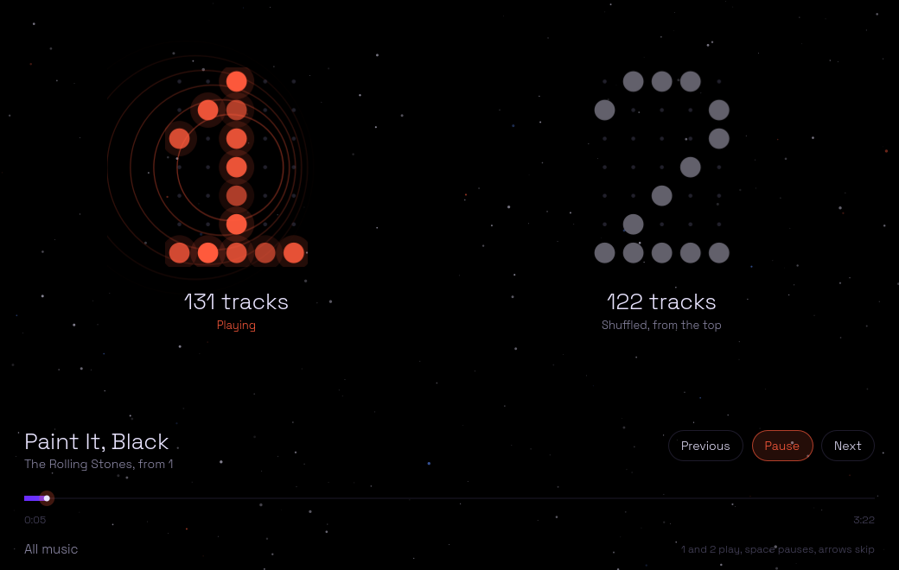
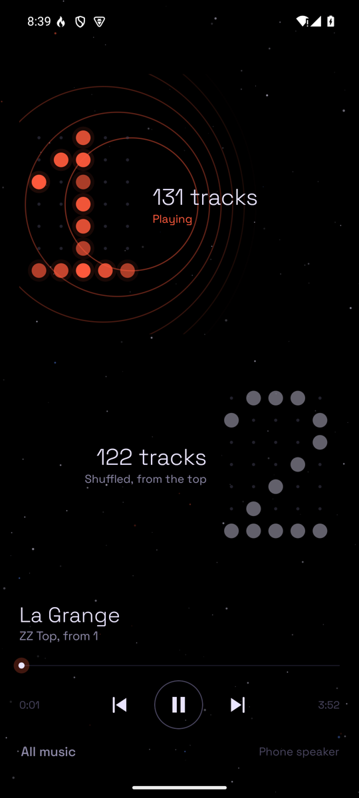

# doppler

Two playlists, one keypress each, and they follow you between your computer and your phone.



Press **1** and playlist 1 plays, shuffled. Press **2** and playlist 2 plays. Press the same key again to pause. Each playlist remembers its own shuffle and where you were in it, on every device: start 1 on your phone on the bus, press Ctrl+1 at your desk, and it carries on from the same song at the same second (the phone pauses itself).

- **A folder is a playlist.** Every folder in your music library is one, with no m3u files to keep up to date. Slots 1 and 2 start out as the folders named `1` and `2`. You can make your own playlists from any tracks, and put any playlist on either slot.
- **Untouched audio.** The file goes straight to the output: no volume scaling, ReplayGain, resampling filter or normalisation, on either side. A 24-bit FLAC stays 24-bit.
- **Out of the way.** On a computer it's a background service you drive from a keyboard shortcut or the media keys. The window only exists while you're looking at it.
- **Careful with the phone's speaker.** The phone asks before playing out loud when nothing is plugged in or connected.



## How it fits together

- **The hub** runs on one always-on machine that has the music. It indexes the library, serves the files and cover art, and keeps each playlist's shuffle and position. Python 3, nothing else (mutagen or ffprobe for tags, ffmpeg for art thumbnails, if present).
- **The player** on a Linux computer is a small daemon around [mpv](https://mpv.io). It plays the computer's own copy of the music if there is one, and streams from the hub otherwise. It keeps playing if the hub goes away, and catches up later.
- **The phone app** (Android 10+) plays the phone's own copy of a track when it has one, and streams it otherwise. It keeps playing after you swipe it away, and has 2×1 and 1×2 home-screen widgets with a 1 and a 2. Tap one to play it, and the widget shows the cover, title and artist with a small red 1 or 2 in the corner. Tap the middle to pause, the left or right edge to go back or skip, and the number to open its playlist. Pausing brings back the 1 and 2.

Whichever device you last pressed play on is the one playing. The others go quiet.

## Install

### The hub

```sh
git clone https://github.com/ieatfood314/doppler ~/.local/share/doppler/app
~/.local/share/doppler/app/install.sh --serve ~/Music
```

It listens on `127.0.0.1:4635`. There's no login, so keep it off the open Internet. Publish it on a private network such as [Tailscale](https://tailscale.com/kb/1312/serve) (`tailscale serve --bg 4635`), or pass `--host` with a LAN address if you trust your LAN.

### A Linux computer

You need `mpv`. The window also needs Qt 6's `qml` runtime (`qt6-declarative`), and the media keys need `python-dbus` and `python-gobject`.

```sh
git clone https://github.com/ieatfood314/doppler ~/.local/share/doppler/app
~/.local/share/doppler/app/install.sh --hub https://your-hub --root /path/to/your/copy/of/the/music
```

Leave out `--root` to stream everything from the hub. Then bind two shortcuts in your desktop's settings: `doppler 1` and `doppler 2`.

### An Android phone

Install the APK from the [latest release](https://github.com/ieatfood314/doppler/releases/latest), or add this repository to [Obtainium](https://obtainium.imranr.dev). Open **All music**, then **Settings**, give it the hub's address and a name for the phone, and optionally let it use the music already on the phone.

## Using it

On the phone, tap a big numeral to play or pause it, and long-press it to open that playlist (find or pick a track, sort it by title, artist, album or how often and how recently you've played each song, change its order, reshuffle, or put another playlist on the slot). **All music** opens the whole library, with search. To make a playlist, long-press tracks to select them, then **Add to playlist**.

On a computer:

```
doppler 1 | doppler 2      play that slot, or pause it if it's already playing
doppler toggle             pause or resume whatever was last playing
doppler next | prev        skip
doppler play NAME          play any playlist by name
doppler status             what's playing, where
doppler ui                 open the window
```

In the window, `1` and `2` play, Space pauses, the arrow keys skip, Ctrl+F searches (inside a playlist when one is open) and Esc closes it.

A song counts as played once you've heard half of it, or four minutes of a long one. Plays from every device add up, and they're counted offline too.

### Per-playlist EQ (optional)

If you use EasyEffects, the player can load a preset whenever a playlist starts. Add this to `~/.config/doppler/config.json`:

```json
"eq": {"f:1": "my-rock-preset", "f:2": "my-focus-preset"}
```

The keys are playlist ids: `f:` followed by the folder's path in the library.

## Updating

Run `update.sh` in the clone. The hub restarts straight away. The player restarts only if it isn't playing, so an update never cuts the music. The phone updates through Obtainium.

## License

MIT. The fonts in `desktop/fonts` and `android/app/src/main/res/font` are [Space Grotesk](https://github.com/floriankarsten/space-grotesk), under the SIL Open Font License (`desktop/fonts/OFL.txt`).
